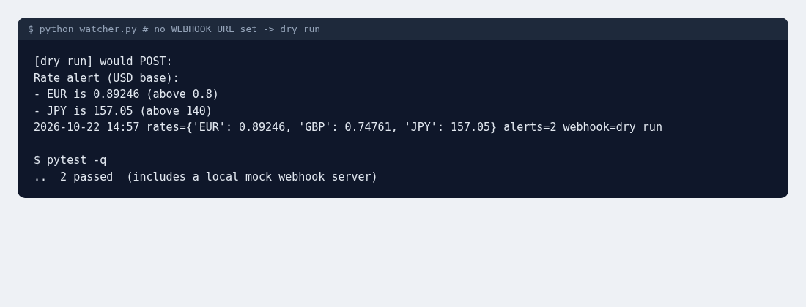

# Scheduled Rate Watcher with Webhook Alerts

A sample automation project. It checks currency exchange rates from the free [Frankfurter API](https://www.frankfurter.app/) (no API key), logs every reading to CSV, and posts an alert to a webhook (Slack or Discord style) when a rate crosses a threshold you set. The same pattern works for prices, stock levels, or any JSON API.



## Problem
People want to know when a number changes without checking a website all day. This is the small script that watches for them.

## Features
- Rules in a JSON file: `above` / `below` thresholds per currency.
- Appends every reading to `output/history.csv` for later charts.
- Sends one combined alert per run to `WEBHOOK_URL` (an env var, so no secrets in the repo). With no URL set, it runs in dry-run mode and prints the alert instead.
- Run once (for cron, Windows Task Scheduler or GitHub Actions) or loop with `--every 60`.
- A sample GitHub Actions workflow (`.github/workflows/watch.yml`) runs it hourly, using a repository secret for the webhook.
- Network calls are injectable, so the tests use a fake API response and a real local mock webhook server.

## Usage
```bash
pip install -r requirements.txt
python watcher.py                                   # one run, dry run
WEBHOOK_URL=https://hooks.example/... python watcher.py --every 60
pytest -q
```

## Sample output
```
[dry run] would POST:
Rate alert (USD base):
- EUR is 0.89246 (above 0.8)
- JPY is 157.05 (above 140)
```

## Tech stack
Python 3, requests, JSON config, CSV logging, GitHub Actions (cron), pytest
